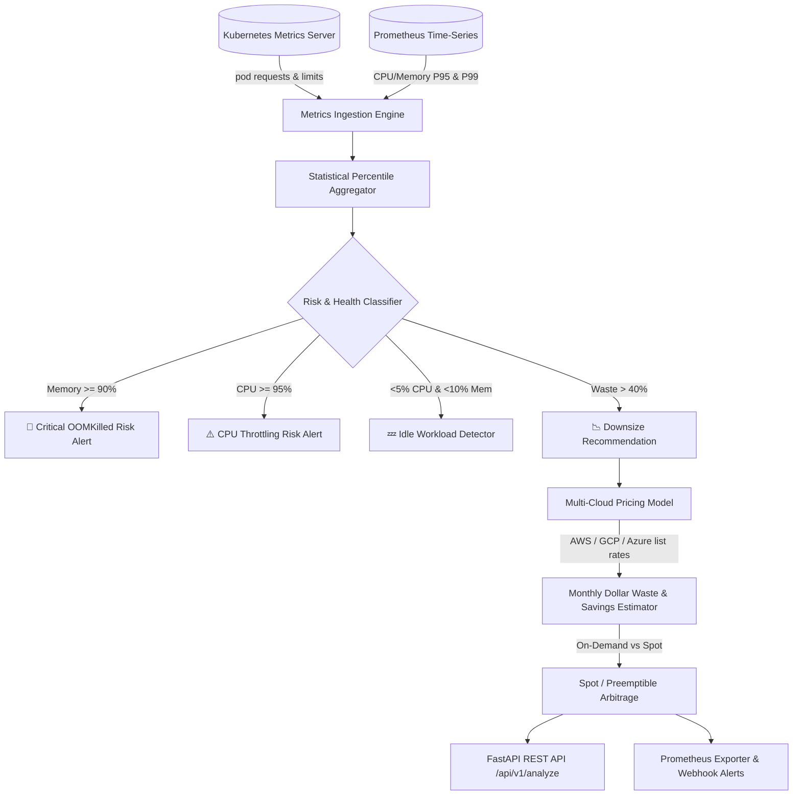

# 💰 Kubernetes Cost Optimizer (FinOps Rightsizing Daemon)

[](https://github.com/txltedxgod/k8s-cost-optimizer/actions/workflows/ci.yml)
[](https://opensource.org/licenses/MIT)
[](https://www.python.org/)
[](https://fastapi.tiangolo.com/)
[](https://kubernetes.io/)
[](https://www.finops.org/)

Autonomous Kubernetes FinOps rightsizing daemon and resource waste optimizer. Continuously evaluates container utilization against provisioned requests/limits, identifies idle pods, predicts OOMKilled evictions and CPU throttling, and models multi-cloud cost reduction across AWS, GCP, and Azure.

---

## 🏛️ Architecture & Dataflow



---

## ✨ Key Features

- **Multi-Cloud Compute Pricing Models**: Built-in cost calculators calibrated for AWS (m6i/c6i/r6i), Google Cloud GKE (e2/n2), Azure AKS (D-series), and On-Premise private cloud.
- **Statistical Percentile Sizing**: Utilizes P90/P95/P99 utilization windows with configurable safety buffers (+20% default headroom) to prevent application performance regression.
- **Critical Risk Detection**:
  - `CRITICAL_OOM_RISK`: Alerts when container working set memory exceeds 90% of requested allocation.
  - `UNDER_PROVISIONED`: Detects aggressive CFS quota CPU throttling.
  - `IDLE`: Identifies dead or zombie pods eligible for consolidation or scale-to-zero.
  - `OVER_PROVISIONED`: Generates exact rightsizing directives with projected monthly savings.
- **Fleet-Wide Batch Analytics**: Analyze hundreds of pods across namespaces in a single API call with aggregated cluster savings metrics.
- **Cloud-Native & Production-Ready**: Health check probes (`/healthz`), Dockerfile, and pre-configured CI pipeline.

---

## 🚀 Quickstart

### Local Setup

```bash
git clone https://github.com/txltedxgod/k8s-cost-optimizer.git
cd k8s-cost-optimizer

python -m venv .venv
source .venv/bin/activate  # On Windows: .venv\Scripts\activate
pip install -r requirements.txt
```

### Run Tests

```bash
pytest -v tests/
```

### Start REST API Server

```bash
uvicorn finops.api:app --host 0.0.0.0 --port 8000 --reload
```

---

## 📡 REST API Reference

### 1. Analyze Single Pod
`POST /api/v1/analyze`

**Request Payload:**
```json
{
  "pod_name": "checkout-service-784f4f78-q9xlt",
  "cpu_request": 4.0,
  "cpu_actual": 0.5,
  "mem_request_mb": 4096.0,
  "mem_actual_mb": 512.0,
  "provider": "aws"
}
```

**Response (200 OK):**
```json
{
  "pod": "checkout-service-784f4f78-q9xlt",
  "status": "OVER_PROVISIONED",
  "cpu_waste_cores": 3.5,
  "mem_waste_mb": 3584.0,
  "waste_percent": 87.5,
  "recommended_cpu_cores": 0.6,
  "recommended_mem_mb": 614.4,
  "current_monthly_cost_usd": 134.19,
  "projected_monthly_cost_usd": 19.74,
  "monthly_waste_usd": 114.45,
  "monthly_savings_usd": 114.45,
  "spot_monthly_savings_usd": 13.82,
  "recommendation": "Rightsize CPU to 0.6 cores (-88% cost)",
  "risk_alerts": []
}
```

### 2. Fleet Analysis (Batch)
`POST /api/v1/analyze/fleet`

Analyzes multiple workloads and returns cluster-wide executive summaries, overall savings percentages, and risk categorizations.

### 3. Pricing Tables
`GET /api/v1/pricing`

Returns current hourly and monthly list rates per compute unit across supported cloud providers.

---

## 🛡️ License

MIT License. See [LICENSE](LICENSE) for details.
